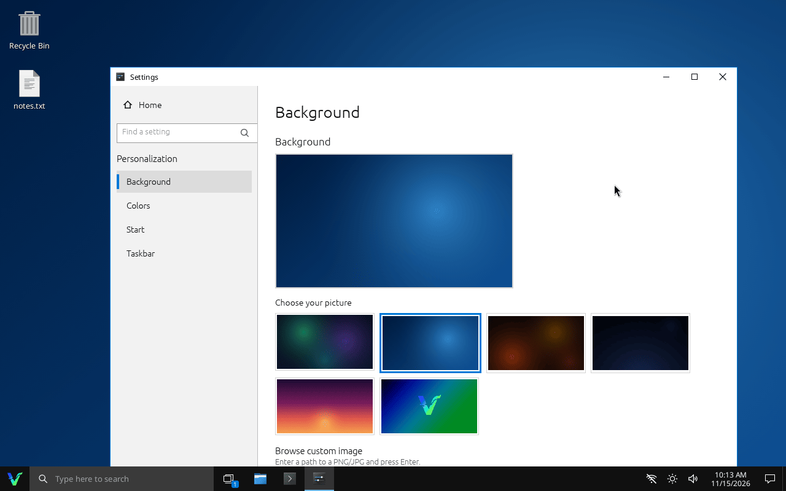
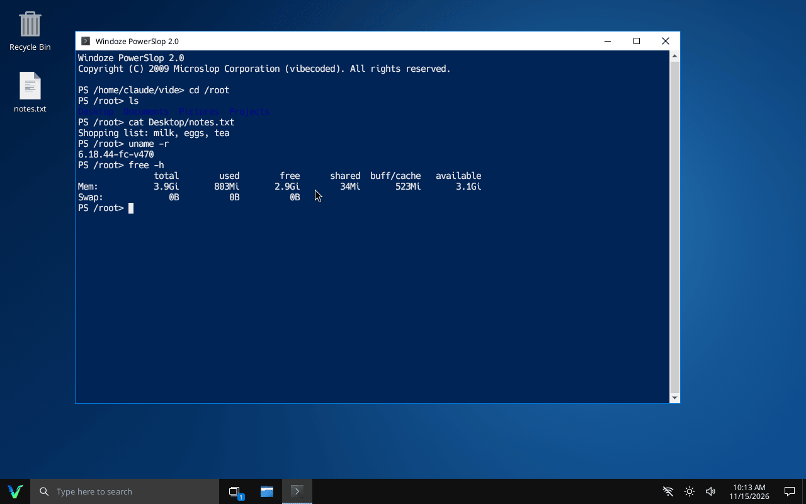
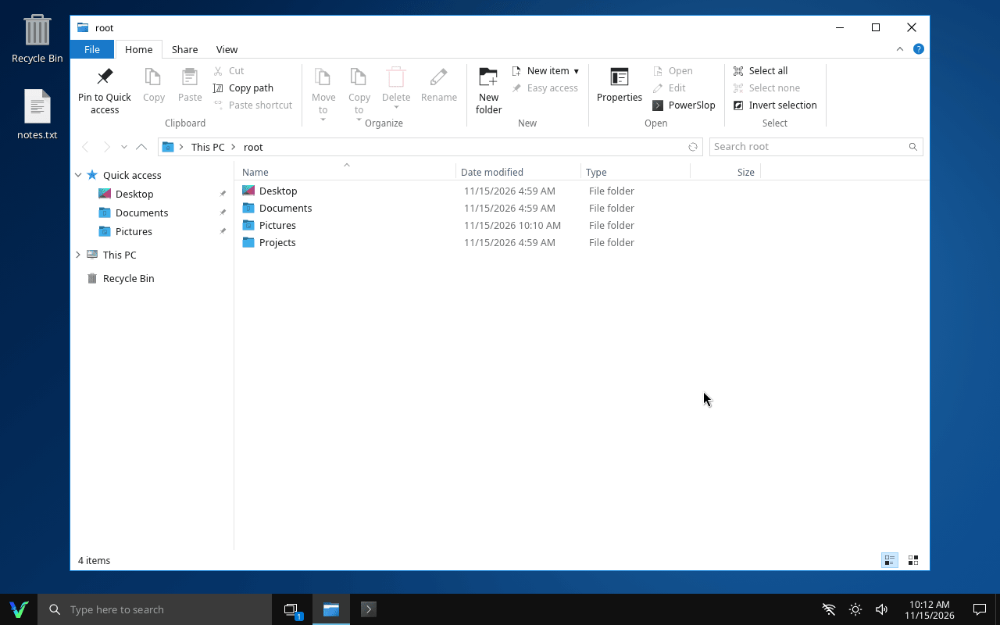
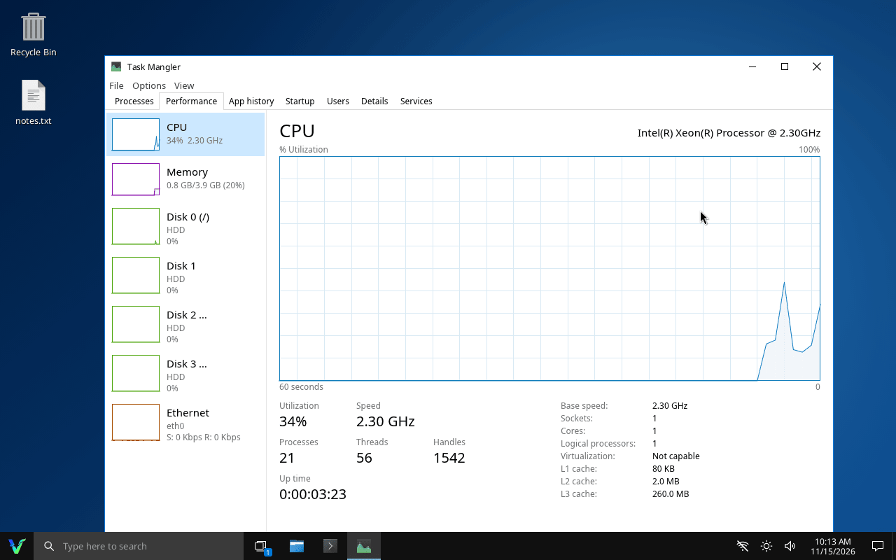
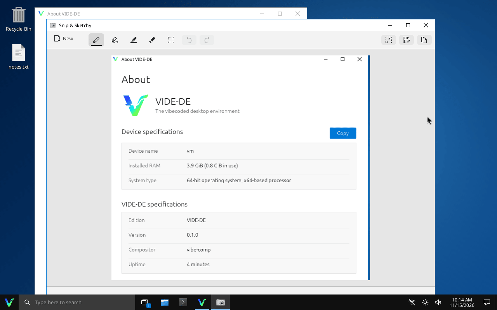
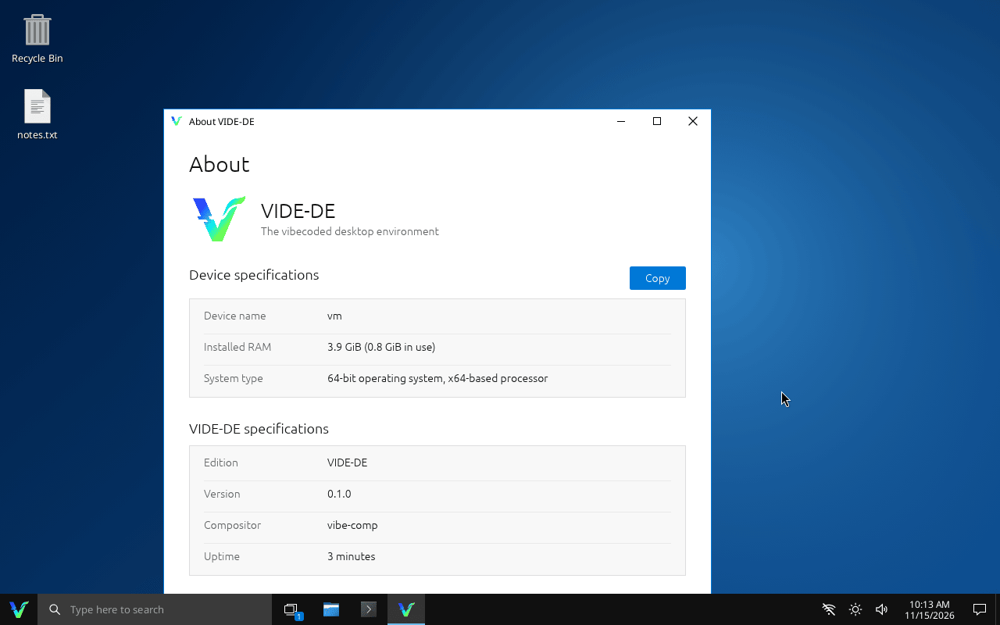

# Built-in Apps

VIDE-DE includes several built-in applications, registered as `.desktop` entries on startup via `apps::install_builtin()`.

## Overview

| App | Command | Desktop ID | Category | Shortcut |
|-----|---------|------------|----------|----------|
| Settings | `vide-settings` | `vide-settings.desktop` | Settings | — |
| PowerSlop | `powerslop` | `powerslop.desktop` | Terminal | `Super+Enter` |
| File Exploder | `file-exploder` | `file-exploder.desktop` | Files | `Super+E` |
| Task Mangler | `task-mangler` | `task-mangler.desktop` | System | `Ctrl+Shift+Esc` |
| Snip & Sketchy | `snip-and-sketchy` | `snip-and-sketchy.desktop` | Graphics | `Win+Shift+S` |
| Emoji Panic | `emoji-panic` | `emoji-panic.desktop` | Utility | `Win+.` |
| About VIDE-DE | `vide-about` | `vide-about.desktop` | Settings | — |

All apps are **separate crates** in the workspace, built with **egui** (except compositor).

---

## Settings (`vide-settings`)

**Crate:** `settings/`

GUI for all compositor settings.

### Features

- **Mouse:** Sensitivity, acceleration, natural scroll, tap-to-click
- **Display:** Resolution, refresh rate, position, scale, primary
- **Wallpaper:** Select from `~/.local/share/vide-de/wallpapers/`
- **Gaming:** XWayland toggle, VRR, HDR (future)
- **Start Menu:** Pinned apps, recent count, search behavior
- **Taskbar:** Position, height, colors, auto-hide, clock format
- **Keyboard:** Repeat rate, delay
- **Theme:** Light/Dark/System, accent color

### Screenshot



### Config

Writes to `~/.config/vide-de/settings.conf`. Compositor reloads within 1 second.

---

## PowerSlop (`powerslop`)

**Crate:** `powerslop/`

Terminal emulator styled like Windoze Terminal / PowerSlop.

### Features

- **Blue theme** (#0078D7 background)
- **Banner** on startup
- **PS> prompt** (PowerSlop style)
- **Tabs** (Ctrl+Shift+T)
- **Split panes** (Ctrl+Shift+D)
- **Configurable** font, size, opacity
- **QuickEdit**: right-click copies the selection (and clears it) or pastes when nothing is selected; `Ctrl+C` copies a selection or sends ^C; `Ctrl+Shift+C` copies; `Ctrl+V` / `Ctrl+Shift+V` paste; `Ctrl+X` goes to the app (nano's Exit)
- **Mouse wheel** scrolls history; apps that track the mouse (vim, htop, mc) get real wheel events, and `Shift+wheel` still scrolls history
- **Uses egui 0.31** (egui_term version)

### Screenshot



### Config

`~/.config/powerslop/config.toml` (future)

---

## File Exploder (`file-exploder`)

**Crate:** `exploder/`

File manager styled like Windoze File Explorer.

### Features

- **Toolbar:** Back, Forward, Up, Refresh, Address bar
- **Sidebar:** Quick access, This PC, Network
- **List/Details/Grid views**
- **Preview pane**
- **Copy/Move/Delete/Rename**
- **This PC lists every drive:** each disk partition with a filesystem, mounted or not
  (read from `/proc/mounts` and udev, like `lsblk`). Opening an unmounted drive mounts it
  through udisks2 (`udisksctl`); the polkit agent asks for a password if the disk needs one.
  Right-click a mounted drive for **Eject** (removable, also powers it off) or **Unmount**.
  Partitions udisks hides (EFI, recovery) are hidden here too.
- **Drag & drop**
- **Context menus**
- **Double-click runs programs**, like Explorer:
  - Downloaded AppImages and binaries are made executable first. An AppImage that fails
    because FUSE isn't installed is retried with `APPIMAGE_EXTRACT_AND_RUN=1`.
  - Command-line programs (nothing in them mentions a windowing library) open in PowerSlop,
    so their output stays readable.
  - A program that quits with an error within a few seconds shows why in the status bar.
    So does one that can't start: a drive mounted `noexec`, the wrong CPU type, a file you
    don't own.
  - `.exe` and `.msi` files run with Wine when it's installed.
  - Scripts run in PowerSlop, and `.desktop` launchers through `gio launch`.

### Shortcuts

| Shortcut | Action |
|----------|--------|
| `Ctrl+N` | New window |
| `Ctrl+W` | Close tab/window |
| `Ctrl+L` | Focus address bar |
| `Alt+Left` | Back |
| `Alt+Right` | Forward |
| `Alt+Up` | Parent folder |
| `F2` | Rename |
| `Delete` | Delete |

### Screenshot



---

## Task Mangler (`task-mangler`)

**Crate:** `mangler/`

Process/performance monitor styled like Windoze Task Manager.

### Features

- **Processes tab:** Name, PID, CPU%, Memory, Disk, Network, GPU
- **Performance tab:** CPU, Memory, Disk, Network, GPU graphs
- **Startup tab:** Enabled/disabled startup apps
- **Users tab:** Session info
- **Details tab:** Full process list
- **Services tab:** Systemd services
- **Kill process** (right-click → End task)
- **Search/filter**

### Screenshot



---

## Snip & Sketchy (`snip-and-sketchy`)

**Crate:** `snip/`

Screenshot markup tool. **Compositor only captures** (via IPC); markup/save/copy lives here.

### Features

- Opens the PNG the compositor saved for a region snip
- **One window for every snip:** later snips open as tabs in the running copy instead of
  starting another process (Ctrl+W closes a tab, Ctrl+Tab switches)
- **Tools:** Ballpoint pen, Pencil, Highlighter, Eraser (whole strokes), Crop
- **Colors and stroke width** per pen (click the active pen again)
- **Undo/Redo** (Ctrl+Z / Ctrl+Y)
- **Save** to `~/Pictures/Screenshots` (Ctrl+S)
- **Copy** to clipboard (Ctrl+C)
- **New** snip (Ctrl+N) through the compositor's `snip` IPC command

### Workflow

```
Win+Shift+S
    │
    ▼
Compositor: region selection overlay → captures → saves a PNG
    │
    ▼
Compositor: runs `snip-and-sketchy <png>`
    │
    ├─ Snip & Sketchy already running? The new launch passes the path over
    │  $XDG_RUNTIME_DIR/snip-and-sketchy-$WAYLAND_DISPLAY.sock and exits;
    │  the running window opens it as a tab and comes forward.
    ▼
User marks up → Save / Copy
```

### Screenshot



---

## About VIDE-DE (`vide-about`)

**Crate:** `about/`

System information viewer using `fastfetch` backend.

### Features

- **OS info:** Distro, kernel, uptime
- **Hardware:** CPU, GPU, Memory, Disk
- **Compositor:** Version, Smithay version, uptime
- **Wayland:** Protocol versions, seat
- **Copy** to clipboard button

### Screenshot



---

## Installation

All apps built with compositor:

```bash
cargo build --release --workspace
# Binaries in target/release/
```

Installed to `~/.local/bin/` or system via package.

## Desktop Entries

Created by `apps::install_builtin()` on compositor startup:

```
~/.local/share/vide-de/applications/
├── vide-settings.desktop
├── powerslop.desktop
├── file-exploder.desktop
├── task-mangler.desktop
├── snip-and-sketchy.desktop
└── vide-about.desktop
```

## Adding New Built-in Apps

1. Create crate in workspace
2. Implement as egui app
3. Add to `apps::install_builtin()` in `src/apps.rs`
4. Rebuild

## Related

- [App Discovery](/vide-de/components/apps/)
- [Start Menu Search](/vide-de/components/search/)
- [Pinned Apps](/vide-de/components/pins/)
- [IPC Socket](/vide-de/components/ipc/)
- [Screenshots](/vide-de/components/screenshot/)